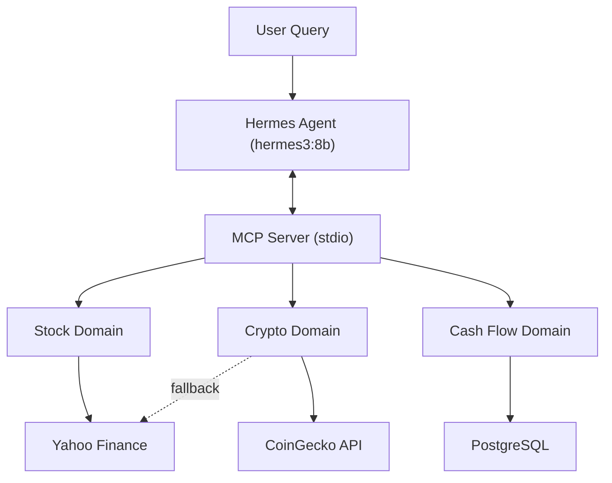

# AGENTS.md — Panduan & Konvensi Project Financial Agent Tools

Dokumen ini ditujukan sebagai panduan kerja, spesifikasi arsitektur, dan referensi instruksi operasional bagi agen AI (maupun developer) yang bekerja pada repositori **financial-agent-tools**.

---

## 1. Ikhtisar Proyek (Project Overview)

**financial-agent-tools** adalah infrastruktur MCP (Model Context Protocol) modular yang menyediakan alat analisis finansial untuk **Hermes Agent**. Sistem ini menyediakan tiga domain independen:

1. **Stock Analysis** — Data saham real-time, histori OHLCV, dan analisis teknikal (SMA, RSI, MACD, Bollinger Bands).
2. **Cryptocurrency** — Harga kripto terkini, histori, dan metrik volatilitas via CoinGecko/Yahoo Finance.
3. **Cash Flow Management** — Pencatatan transaksi pendapatan/pengeluaran, laporan arus kas, dan ringkasan bulanan.

### Spesifikasi Inti:
- **Runtime**: Python 3.11+ (virtual environment di `./venv`)
- **MCP SDK**: `mcp>=2.0` (`MCPServer` — alias `FastMCP`)
- **Transport**: stdio (untuk integrasi lokal dengan Hermes Agent)
- **Database**: PostgreSQL 16 (via Docker Compose) dengan migrasi Alembic
- **Validasi Data**: Pydantic v2 & pydantic-settings
- **ORM**: SQLAlchemy 2.x
- **HTTP Client**: httpx (dengan retry dan rate-limit handling)
- **Kalkulasi Monetér**: Python `Decimal` (bukan `float`)

---

## 2. Arsitektur & Alur Kerja



### Layering per Domain:
```
tools.py       ← Registrasi tool MCP (boundary transport)
service.py     ← Orkestrasi logika bisnis
provider.py    ← Abstraksi sumber data eksternal (Stock/Crypto)
calculations.py ← Fungsi kalkulasi murni
repository.py  ← Akses database (Cash Flow)
schemas.py     ← Model input/output Pydantic
```

---

## 3. Menjalankan Proyek

### A. Prasyarat
```bash
# 1. Start PostgreSQL
docker compose up -d

# 2. Aktivasi venv & install
source venv/bin/activate
pip install -e ".[dev]"

# 3. Jalankan migrasi database
alembic upgrade head

# 4. Verifikasi tools
python scripts/check_mcp.py    # → 11 tools terdaftar

# 5. Jalankan MCP Server
python -m financial_tools.server
```

### B. Testing
```bash
PYTHONPATH=src pytest tests/unit/ -v
```
Tests menggunakan mock provider dan SQLite in-memory — tidak memerlukan API atau PostgreSQL.

---

## 4. Panduan Modifikasi & Konvensi Kode

### 1. Menambahkan Tool Baru
1. **Definisikan skema** di `schemas.py` domain terkait.
2. **Implementasikan logika bisnis** di `service.py` (atau `calculations.py` untuk kalkulasi murni).
3. **Daftarkan tool** di `tools.py` domain dengan `@server.tool()` decorator.
4. **Tangani exception** — selalu `try-except` dan kembalikan pesan error deskriptif (jangan bocorkan SQL/credential).
5. **Tambahkan unit test** di `tests/unit/`.

### 2. Konvensi Penting
- **Import `FastMCP`** selalu dari `financial_tools.shared.types` (berisi alias kompatibel MCP v1/v2).
- **Jangan gunakan `float` untuk uang** — selalu `Decimal` untuk kalkulasi monetér.
- **Setiap query harus scoped ke `user_id`** — jangan pernah query tanpa filter user.
- **Semua log ke stderr** — stdout reserved untuk MCP stdio protocol.
- **Jangan commit `.env`** — gunakan `.env.example` sebagai referensi.

### 3. Menambahkan Provider Baru (Stock/Crypto)
1. Buat class baru yang mengimplementasi `StockDataProvider` atau `CryptoDataProvider` ABC.
2. Tambahkan ke `MockProvider` untuk testing.
3. Perbarui service constructor agar menerima provider melalui dependency injection.

### 4. Menambahkan Tabel/Kolom Database
1. Modifikasi model di `shared/models.py`.
2. Generate migration: `alembic revision --autogenerate -m "deskripsi"`.
3. Apply: `alembic upgrade head`.
4. Rollback: `alembic downgrade -1`.

---

## 5. Struktur Berkas Repositori

```text
financial-agent-tools/
├── AGENTS.md                   # Dokumen ini
├── README.md                   # Quick start & overview
├── pyproject.toml              # Konfigurasi proyek Python
├── compose.yaml                # Docker Compose (PostgreSQL)
├── Dockerfile                  # Container image
├── alembic.ini                 # Konfigurasi migrasi
├── .env.example                # Template environment variables
├── .gitignore
├── agent.py                    # Legacy: skrip agen lama (referensi)
│
├── src/financial_tools/
│   ├── server.py               # Entry point MCP server
│   ├── config.py               # Settings via pydantic-settings
│   ├── dependencies.py         # Composition root
│   ├── stocks/                 # Domain saham
│   │   ├── tools.py / service.py / provider.py / calculations.py / schemas.py
│   ├── crypto/                 # Domain kripto
│   │   ├── tools.py / service.py / provider.py / calculations.py / schemas.py
│   ├── cashflow/               # Domain arus kas
│   │   ├── tools.py / service.py / repository.py / reports.py / schemas.py
│   ├── shared/                 # Infrastruktur bersama
│   │   ├── database.py / models.py / exceptions.py / logging.py / http_client.py / security.py / types.py
│   └── migrations/             # Alembic migrations
│
├── tests/
│   ├── unit/                   # test_stocks.py, test_crypto.py, test_cashflow.py
│   └── conftest.py             # Fixtures (SQLite in-memory, mock providers)
│
├── scripts/
│   └── check_mcp.py            # Tool discovery inspector
│
└── docs/
    ├── architecture.md         # Arsitektur & data flow
    ├── tool-catalog.md         # Katalog 11 MCP tools & skema
    ├── database-schema.md      # ERD & migrasi
    └── hermes-setup.md         # Konfigurasi Hermes MCP
```

---

## 6. MCP Tool Inventory (11 Tools)

| # | Domain | Tool | Deskripsi |
|---|--------|------|-----------|
| 1 | Stock | `get_stock_quote` | Harga saham terkini (BBCA.JK, AAPL, NVDA) |
| 2 | Stock | `get_stock_history` | Data historis OHLCV |
| 3 | Stock | `analyze_stock` | Indikator teknikal & metrik risiko |
| 4 | Crypto | `get_crypto_quote` | Harga kripto terkini (BTC, ETH, SOL) |
| 5 | Crypto | `get_crypto_history` | Histori harga kripto |
| 6 | Crypto | `analyze_crypto` | Return, volatilitas, moving average |
| 7 | Cash Flow | `record_transaction` | Catat pendapatan/pengeluaran |
| 8 | Cash Flow | `list_transactions` | Daftar transaksi dengan filter |
| 9 | Cash Flow | `get_cashflow_report` | Laporan arus kas lengkap |
| 10 | Cash Flow | `get_expense_breakdown` | Breakdown pengeluaran per kategori |
| 11 | Cash Flow | `get_monthly_summary` | Ringkasan bulanan + perbandingan bulan sebelumnya |
