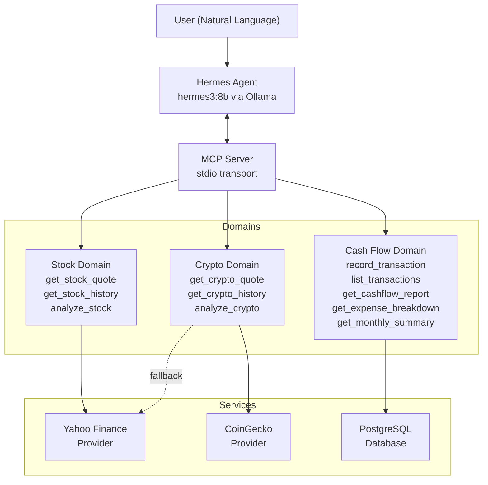
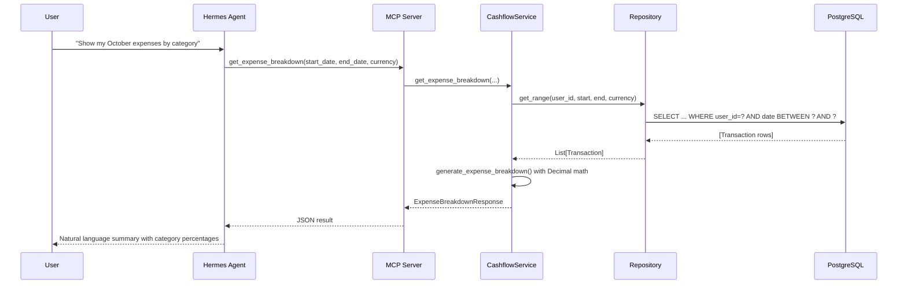
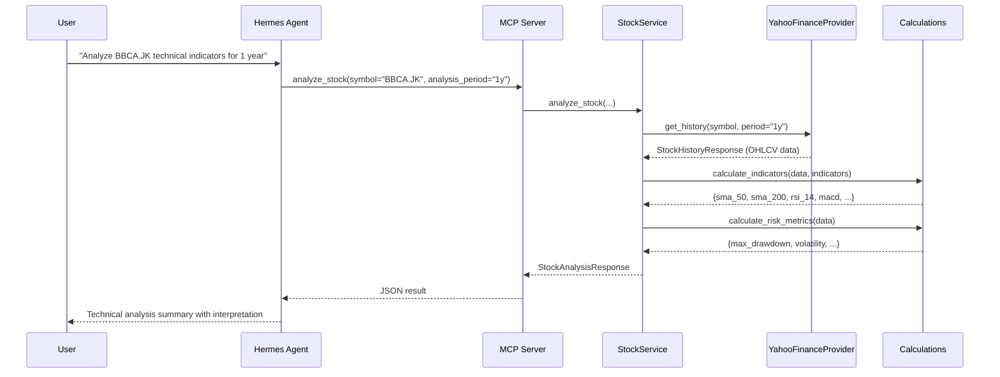

# Architecture

## System Overview

Financial Agent Tools is a modular MCP (Model Context Protocol) infrastructure providing Hermes Agent with deterministic financial tools across three independent domains.



## Layered Architecture

Each domain follows a consistent internal layering:

```
tools.py      ← MCP tool registration (transport boundary)
service.py    ← Business logic orchestration
provider.py   ← External data source abstraction (Stock/Crypto only)
calculations.py ← Pure calculation functions
repository.py ← Database access (Cash Flow only)
schemas.py    ← Pydantic input/output models
```

### Design Decisions

1. **Business logic is transport-independent**: Services and calculations have no dependency on MCP. They can be reused by a REST API, CLI, or web app.

2. **Provider abstraction**: Stock and Crypto domains use an abstract base class (`StockDataProvider`, `CryptoDataProvider`) with concrete implementations. Mock providers are included for deterministic testing.

3. **Hybrid Crypto Provider**: The `HybridCryptoProvider` attempts CoinGecko first and falls back to Yahoo Finance, providing resilience without requiring API keys.

4. **Decimal arithmetic**: All monetary calculations use Python `Decimal` — never `float` — to prevent rounding errors in financial reports.

5. **Single MCP server**: All three domains register tools on one `MCPServer` instance. This simplifies local development while the architecture supports splitting into independent servers later.

6. **SQLite fallback**: For local development without PostgreSQL, the database URL can be set to `sqlite:///./financial_tools.db`. Tests always use in-memory SQLite.

## Data Flow: Cash Flow Report



## Data Flow: Stock Analysis


