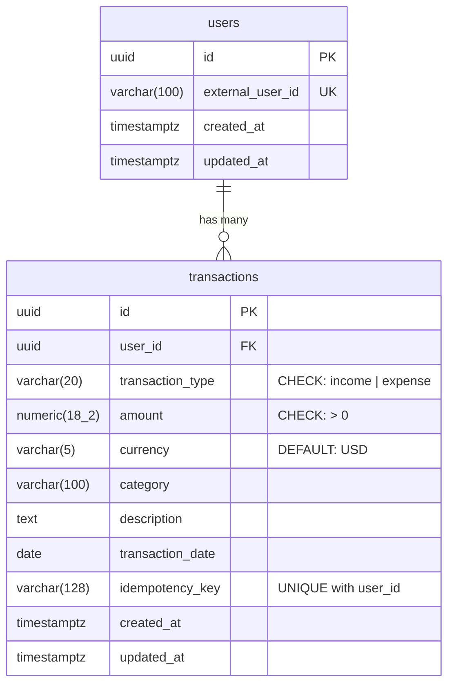

# Database Schema

## Entity Relationship Diagram



## Table Details

### `users`

| Column | Type | Constraints | Description |
|--------|------|-------------|-------------|
| `id` | `UUID` | PRIMARY KEY | Internal user identifier |
| `external_user_id` | `VARCHAR(100)` | UNIQUE, NOT NULL | Stable application identity |
| `created_at` | `TIMESTAMPTZ` | NOT NULL, DEFAULT now() | Record creation time |
| `updated_at` | `TIMESTAMPTZ` | NOT NULL, DEFAULT now() | Last update time |

### `transactions`

| Column | Type | Constraints | Description |
|--------|------|-------------|-------------|
| `id` | `UUID` | PRIMARY KEY | Transaction identifier |
| `user_id` | `UUID` | FK → users.id, ON DELETE CASCADE | Owner scope |
| `transaction_type` | `VARCHAR(20)` | CHECK ('income', 'expense') | Income or expense |
| `amount` | `NUMERIC(18,2)` | CHECK (> 0) | Monetary amount in Decimal |
| `currency` | `VARCHAR(5)` | NOT NULL, DEFAULT 'USD' | ISO currency code |
| `category` | `VARCHAR(100)` | NOT NULL | Classification tag |
| `description` | `TEXT` | NOT NULL, DEFAULT '' | Memo/notes |
| `transaction_date` | `DATE` | NOT NULL | Date of transaction |
| `idempotency_key` | `VARCHAR(128)` | NULLABLE, UNIQUE(user_id, key) | Dedup key |
| `created_at` | `TIMESTAMPTZ` | NOT NULL, DEFAULT now() | Record creation time |
| `updated_at` | `TIMESTAMPTZ` | NOT NULL, DEFAULT now() | Last update time |

## Indexes

| Index Name | Table | Columns | Purpose |
|------------|-------|---------|---------|
| `ix_users_external_user_id` | users | external_user_id | User lookup |
| `ix_transactions_user_id` | transactions | user_id | User scoping |
| `ix_transactions_transaction_date` | transactions | transaction_date | Date range queries |
| `ix_transactions_category` | transactions | category | Category filtering |
| `ix_user_tx_date` | transactions | user_id, transaction_date | Report date-range scans |
| `ix_user_tx_category` | transactions | user_id, category | Category-scoped reports |
| `uq_user_idempotency_key` | transactions | user_id, idempotency_key | Idempotency enforcement |

## Migrations

### Apply migrations

```bash
alembic upgrade head
```

### Roll back one step

```bash
alembic downgrade -1
```

### Roll back to empty

```bash
alembic downgrade base
```

### View current revision

```bash
alembic current
```

### Generate new migration after model changes

```bash
alembic revision --autogenerate -m "description_of_change"
```
